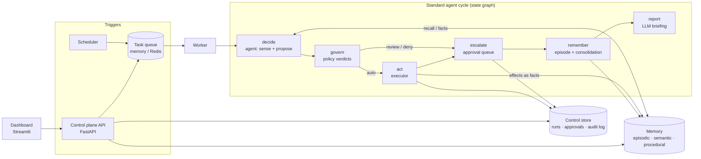

# Cortex

**A persistent-memory operating system for autonomous agents that run 24/7.**

Cortex gives long-running agents three things most agent frameworks leave to you:
a memory that learns what is true over time, guardrails that decide which actions
run without a human, and an always-on runtime with a full audit trail. It ships with
ad-optimization, security-monitoring and research agents; CRM, creative generation and
long-horizon workflow agents are designed to plug into the same loop and share the
same memory.

It is infrastructure, not a chat interface. The unit of work is a *cycle*, not a
conversation: sense, decide, govern, act, remember, report. It repeats on a schedule
for weeks.

---

## Key features

- **Layered memory, not just a vector store.** Episodic events, semantic facts and
  procedural track records, each with its own lifecycle. Facts are versioned, carry
  confidence and link back to the episodes that support them.
- **Consolidation.** Agents never write inferred beliefs directly. Observations are
  promoted to facts only when corroborated across runs; unproven ones expire. Things
  Cortex *did* are recorded as facts immediately, with full confidence.
- **Hierarchical scopes.** `acme`, `acme/ads`, `acme/ads/eu`. A child scope reads its
  parents' memory and can override it; parents never see children. The same install
  serves one person or a multi-team org.
- **Policy-governed autonomy.** Every proposed action is scored for risk and gets a
  verdict: `auto`, `review` (human approval queue) or `deny`. Caps on budget change
  size and daily auto-action volume are config, not code.
- **One cycle for every agent.** Agents only sense and decide. Guardrails, execution,
  audit logging, memory write-back and reporting are shared, so a new agent gets them
  for free.
- **Human verdicts become memory.** Approvals and rejections are stored as
  high-importance episodes the agents can recall.
- **Always-on runtime.** Scheduler + workers over an in-memory or Redis queue
  (reliable-queue pattern), a FastAPI control plane and a Streamlit operator dashboard.
- **Runs with no API key.** Decisions are deterministic and tested; the LLM writes
  briefings and research. An offline provider keeps everything runnable locally.

## Architecture



| Layer | Module | Responsibility |
|---|---|---|
| Agents | `cortex.agents` | Read inputs and memory, return proposals and observations. No side effects. |
| Orchestration | `cortex.orchestration` | State graph, policy, executor, queue, scheduler, worker. |
| Memory | `cortex.memory` | Storage, retrieval scoring, consolidation. |
| Runtime | `cortex.runtime` | Wires it together; owns runs, approvals and the audit log. |
| Interfaces | `cortex.api`, `cortex.cli`, `dashboard/` | Operate and observe. |

More detail: [docs/architecture.md](docs/architecture.md) and
[docs/memory.md](docs/memory.md).

## Current status

Version 0.1. Early, working, and honest about it.

**Working and tested**

- Memory store: episodes, versioned facts with provenance, procedures, FTS5 recall with
  relevance / recency / importance blending, hierarchical scopes.
- Consolidation: corroboration threshold, confidence via noisy-OR, TTL expiry,
  importance decay, idempotent reinforcement.
- State-graph runtime with routing, step limits and per-step timing and errors.
- Policy engine (risk ceiling, budget-change cap, daily auto-action limit, deny list).
- Executor with dry-run mode, audit log and memory write-back.
- Three reference agents: `ads_optimizer`, `security_monitor`, `research`.
- Control-plane API, CLI, scheduler + worker (retries, acks), in-memory and Redis queues.
- Docker compose stack (API, worker on Redis, dashboard) run locally end to end:
  scheduled cycles, queued tasks, and approvals made from the dashboard.
- End-to-end example: two simulated days of ads review with a human approval in between.

**Not built yet**: see [Current limitations](#current-limitations) and the roadmap.

## Tech stack

| Concern | Choice |
|---|---|
| Language | Python 3.11+, fully type-hinted |
| Control plane | FastAPI + Uvicorn |
| Orchestration | Built-in async state graph (LangGraph-shaped API; adapter on the roadmap) |
| Memory | SQLite (WAL) with FTS5; Postgres is next |
| Queue | Redis (reliable queue via `BLMOVE`), in-memory fallback |
| LLM | Anthropic Claude (optional), deterministic offline provider |
| Dashboard | Streamlit |
| Packaging | Docker, docker compose |
| Quality | pytest, ruff, mypy (strict), GitHub Actions |

## Run locally

Requirements: Python 3.11+. Docker is optional.

```bash
git clone https://github.com/sebas8866/cortexv1.git
cd cortexv1
python -m venv .venv
source .venv/bin/activate          # Windows: .venv\Scripts\activate
pip install -e ".[dev]"
```

Run the end-to-end example (no keys, no network, everything is a dry run):

```bash
python examples/ads_daily_review.py
```

Run tests:

```bash
pytest
```

Use the CLI against the bundled config (state goes to `./var/cortex.db`):

```bash
cortex agents
cortex run ads_optimizer --scope acme/ads
cortex approvals
cortex approve <approval-id> --by you
cortex memory facts campaign:c_101 --scope acme/ads
cortex memory search "paused campaign" --scope acme/ads
```

Start the control plane and dashboard:

```bash
cortex serve                                   # http://127.0.0.1:8000/docs
pip install -e ".[dashboard]"
streamlit run dashboard/app.py                 # http://localhost:8501
```

Run the always-on loop (scheduler + worker):

```bash
cortex worker
```

Everything in Docker (API, worker on Redis, dashboard):

```bash
cp .env.example .env
docker compose up --build
# API: http://127.0.0.1:8000/docs   Dashboard: http://127.0.0.1:8501
```

To have Claude write briefings and research instead of the offline provider, set
`ANTHROPIC_API_KEY` in `.env` and `CORTEX_LLM_PROVIDER=anthropic`, and install the
`llm` extra (`pip install -e ".[llm]"`).

## Current limitations

- **No live platform adapters yet.** Executors run in dry-run mode. Live ad platform,
  CRM and firewall adapters are interfaces waiting to be written; Cortex refuses live
  mode for any action kind without one.
- **SQLite only.** Fine for one node and modest volume. Multi-node deployments need the
  Postgres backend, which is not built.
- **Lexical recall only.** BM25 over FTS5. No embeddings yet, so paraphrases with no
  shared words are missed.
- **Synchronous storage calls** inside async code. Acceptable at current scale; it will
  block the event loop under heavy load.
- **Scheduler state is in-process.** A restart fires every schedule once. Two scheduler
  processes would double-schedule; run one.
- **No auth on the API.** Compose binds it to 127.0.0.1; put your own auth proxy in front
  before exposing it.
- **`POST /tasks` needs the Redis backend.** With the in-memory queue the API refuses it
  (503) because no worker shares its process; use `POST /runs` instead.
- **Example agents use rules on exported data**, not live APIs. They show the contract
  and the memory interplay; they are not tuned strategies.
- **Not yet battle-tested** on long real-world deployments.

## Roadmap (near term)

1. Postgres memory and control backends (same schema, `pgvector` for embeddings).
2. Hybrid recall: BM25 + embeddings + the existing recency / importance signals.
3. First live adapters: Google Ads and Meta budget/pause, a webhook notifier, a CRM.
4. Persistent scheduler state and leader election for multi-worker installs.
5. API authentication, per-scope API keys and role-based approval rights.
6. LangGraph adapter for workflows that need checkpointed interrupts mid-cycle.
7. LLM-assisted consolidation: summarise old episodes into facts, with provenance kept.
8. More agents: CRM follow-up, creative generation with brand memory, long-horizon
   project tracking.

## Philosophy

**Memory is the product.** An agent that forgets what it did yesterday cannot be left
alone for a month. Cortex treats memory as a database with semantics: what happened,
what is believed, how well each way of acting has worked, and why.

**Beliefs have to be earned.** A single LLM inference is not a fact. Cortex keeps
observations, evidence and confidence apart, and keeps history when the world changes.

**Autonomy is a budget.** "Fully autonomous" is not a useful setting for systems that
spend money or touch production. Cortex makes the boundary explicit and auditable, and
moves it as track records accumulate.

**Rules decide, models explain.** Where a decision moves money or blocks access, it
should be deterministic and testable. Models are used where language is the job.

**Same core from one person to an org.** Scopes, policy and the audit log are there
from day one, not bolted on when the first enterprise customer asks.

## Repository layout

```
cortex/
├── config/cortex.yaml          runtime configuration
├── src/cortex/
│   ├── agents/                 agent contract, registry, reference agents
│   ├── memory/                 models, store (SQLite + FTS5), consolidation
│   ├── orchestration/          graph, cycle, policy, executor, queue, worker
│   ├── runtime/                Cortex runtime, control-plane store
│   ├── api/                    FastAPI control plane
│   ├── cli.py, config.py, llm.py, db.py
├── dashboard/app.py            Streamlit operator UI
├── examples/                   runnable flows and sample data
├── tests/                      unit and end-to-end tests
├── docs/                       architecture, memory, deployment
├── Dockerfile, docker-compose.yml
└── .github/workflows/ci.yml
```

## License

Apache-2.0. See [LICENSE](LICENSE).
